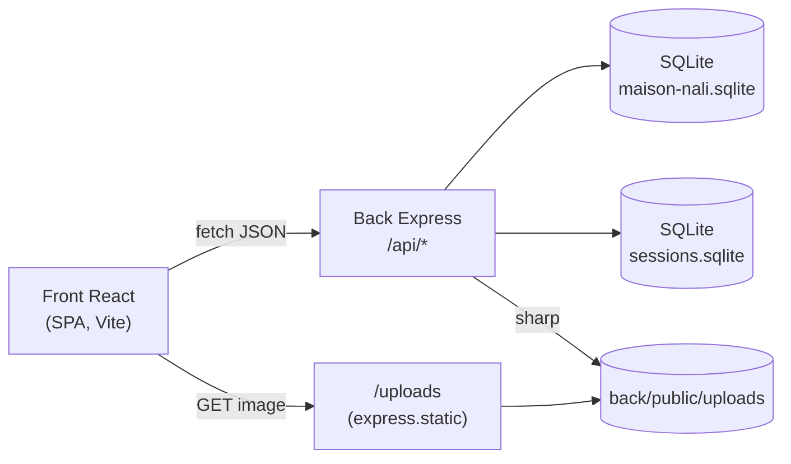

# Maison Nali

Site vitrine administrable pour la pâtisserie algérienne Maison Nali (Paris) : pages publiques (accueil, catalogue de pâtisseries, événements, à propos, adresse, mentions légales) entièrement éditables depuis un espace d'administration, sans intervention sur le code pour changer un texte, une photo ou un horaire.

Vérifié dans le code le 2026-10-10 (branche `docs/v1`).

## Fonctionnalités

**Site public**
- 6 pages publiques + fiche produit détaillée (`/patisseries/:id`).
- Contenu de chaque page composé de blocs typés (Hero, bloc-histoire, bloc-localisation, bloc-événements, bloc-entête, grille de pâtisseries), chacun éditable indépendamment depuis l'admin.
- Catalogue de pâtisseries avec photo, description, vidéo externe optionnelle, point focal de recadrage ajustable.
- Bannière d'annonce avec fenêtre de visibilité par dates.
- Horaires d'ouverture, coordonnées (téléphone, adresse, réseaux sociaux) centralisés.
- Galerie "nos réalisations" (événements), carrousel avec pause, limitée à 5 photos.
- SEO : titres/descriptions uniques par page, Open Graph, balise canonique, données structurées `LocalBusiness` (JSON-LD), `robots.txt`/`sitemap.xml` générés au build.
- Accessibilité : navigation clavier complète (menu mobile avec piège de focus), contrastes conformes WCAG, structure sémantique (`<main>`, landmarks).

**Espace d'administration** (`/admin`, authentification requise)
- Édition de chaque bloc de chaque page.
- Gestion du catalogue de pâtisseries (création, édition, suppression, réorganisation par glisser-déposer).
- Gestion de la galerie photos événements (max 5).
- Gestion de la bannière d'annonce.
- Gestion des coordonnées et horaires.
- Changement de mot de passe.
- Upload de photo avec traitement automatique (voir ci-dessous).

**Traitement des images à l'upload**
Chaque photo envoyée depuis l'admin est automatiquement : réorientée selon ses données EXIF, débarrassée de toutes ses métadonnées (GPS inclus), redimensionnée (largeur max 1600px, jamais agrandie) et recompressée (JPEG qualité 80/mozjpeg, PNG compressé, WebP qualité 80) — sans conversion de format. Détail : `docs/ARCHITECTURE.md`.

## Stack

| Couche | Techno | Version |
|---|---|---|
| Front | React | 19.2 |
| Front | React Router | 7.18 |
| Front | Vite | 8.2 |
| Front | Tailwind CSS | 4.3 |
| Back | Node.js / Express | 5.2 |
| Back | SQLite (`better-sqlite3`) | 13.0 |
| Back | `express-session` + store SQLite maison | 1.19 |
| Back | `sharp` (traitement d'image) | 0.35 |
| Back | `bcrypt`, `helmet`, `cors`, `compression`, `multer` | — |
| Tests | `node:test` (natif Node) + `supertest` | — |

Versions exactes : `back/package.json`, `front/package.json`.

## Architecture (vue rapide)



Détail complet (flux de requête public/admin, pipeline d'upload, sections JSON, sessions) : **`docs/ARCHITECTURE.md`**.

## Installation rapide

Prérequis : Node.js (voir `SETUP.md` pour le détail des pièges Windows connus — compilation de `better-sqlite3`/`bcrypt`).

```bash
# Back
cd back
npm install
cp .env.example .env      # remplir SESSION_SECRET au minimum
npm run init-db
node src/db/init-admin.js <email> <mot-de-passe>
npm run content:import
node src/server.js

# Front (autre terminal)
cd front
npm install
cp .env.example .env
npm run dev
```

Procédure détaillée, ordre exact et pièges connus : **`SETUP.md`**. Déploiement en production : **`docs/DEPLOY.md`**.

## Scripts utiles

**Back** (`cd back`)

| Commande | Effet |
|---|---|
| `npm start` | Démarre le serveur (`src/server.js`) |
| `npm test` | Lance les 129 tests (`node:test`) contre une base SQLite de test jetable |
| `npm run init-db` | Crée `back/data/maison-nali.sqlite` depuis `src/db/database.sql` (une fois) |
| `npm run content:import` | Importe le contenu éditorial réel depuis `back/seed/contenu.json` (une fois, après `init-admin.js`) |
| `npm run backup` | Sauvegarde `data/*.sqlite` (hors sessions) + `public/uploads/` dans `Sauvegardes/<horodatage>/` |
| `node src/db/optimize-uploads.js [--apply]` | Réapplique le pipeline d'optimisation d'image aux fichiers déjà uploadés (dry-run par défaut) |

**Front** (`cd front`)

| Commande | Effet |
|---|---|
| `npm run dev` | Serveur de développement Vite |
| `npm run build` | Build de production (`dist/`) + génération `robots.txt`/`sitemap.xml` |
| `npm run preview` | Sert le build de production localement |
| `npm run lint` | ESLint |

## Structure des dossiers

Vue d'ensemble ci-dessous ; détail fichier par fichier (rôle en une ligne) : **`docs/STRUCTURE.md`**.

```
back/
  src/
    routes/         # définition des endpoints HTTP, validation, codes de retour
    repositories/    # accès SQL (requêtes préparées), pas de logique HTTP
    utils/           # fonctions pures (validation, détection image, optimisation sharp)
    middleware/      # requireAuth, rateLimitLogin
    db/              # connexion SQLite, schéma, import/export de contenu, sauvegarde, maintenance
  data/              # bases SQLite (gitignoré)
  public/uploads/    # photos uploadées (gitignoré sauf .gitkeep)

front/
  src/
    pages/           # une entrée par route (public/ et admin/)
    components/      # composants d'affichage public + admin/editeurs (formulaires)
    hooks/           # usePageContent, usePageSeo, useLocalBusinessSchema
    utils/           # urlImage, sessionExpiree, telephone, bannerStatus...

docs/                # cette documentation technique
Documentation/        # rapports d'audit (sécurité, a11y/perf) et preuves (JSON Lighthouse/axe-core)
Schémas/              # anciens schémas de conception — obsolètes, voir note en fin de fichier
```

## Tests

129 tests (`node:test`), tous verts à la date de ce document. Couverture détaillée par fichier, cahier de recettes manuel (32 scénarios) : **`docs/TESTS.md`**.

```bash
cd back && npm test
```

## Sécurité

23 constats sur 25 corrigés lors de l'audit sécurité (`Documentation/Securite_Passe1_2026-10-09.md`), synthétisés par catégorie OWASP Top 10:2021 dans **`docs/SECURITE.md`**. Points clés : requêtes SQL 100% paramétrées, mots de passe bcrypt (coût 12), sessions régénérées à la connexion + store SQLite persistant, rate limiting sur le login, `helmet()`, CORS restreint à une origine, upload validé sur signature binaire réelle (pas le `Content-Type` déclaré), vulnérabilité critique de dépendance corrigée (`proxy-addr`).

## Performance — résultats Lighthouse (état final)

Mesuré le 2026-10-10 après le lot d'optimisation des images (médiane de 3 runs par page/mode, protocole complet et rapports bruts : `Documentation/A11y_Perf_Passe1_2026-10-09.md`, section "Après traitement des images").

| Page | Perf desktop | Perf mobile | A11y | LCP mobile | CLS mobile | Poids de page |
|---|---|---|---|---|---|---|
| Accueil | 99 | 82 | 100 | 5.0s | 0 | 1657 Kio |
| Pâtisseries | 100 | 89 | 100 | 3.7s | 0 | 1522 Kio |
| À propos | 99 | 97 | 100 | 2.5s | 0 | 519 Kio |
| Adresse | 100 | 95 | 100 | 2.7s | 0.066 | 662 Kio |
| Événements | 99 | 80 | 100 | 5.3s | 0 | 1079 Kio |
| Mentions légales | 100 | 98 | 100 | 2.4s | 0.012 | 190 Kio |

axe-core : 0 violation sur les 6 pages publiques. Le LCP mobile résiduel sur Accueil/Événements est diagnostiqué (chaîne de dépendance réseau côté rendu client, piste de pré-rendu pour une V2) dans `Documentation/A11y_Perf_Passe1_2026-10-09.md`, section "Limites connues".

## Documentation

| Document | Contenu |
|---|---|
| `docs/STRUCTURE.md` | Arbre annoté du dépôt (rôle de chaque fichier), schéma du flux back route→validateur→repository, scripts utilitaires |
| `docs/ARCHITECTURE.md` | Couches, flux de requête public/admin, sections JSON, sessions, pipeline d'upload |
| `docs/API.md` | Toutes les routes : méthode, auth, corps, validations, codes de retour |
| `docs/BASE-DE-DONNEES.md` | MCD/MLD/MPD, dictionnaire des tables, vérification contre le schéma réel |
| `docs/DEPLOY.md` | Variables d'environnement, build, pm2/systemd, nginx, sauvegarde/restauration |
| `docs/SECURITE.md` | Mesures en place par catégorie OWASP, limites connues |
| `docs/TESTS.md` | Couverture des 129 tests, cahier de recettes manuel |
| `SETUP.md` | Installation détaillée pas à pas |
| `Documentation/` | Rapports d'audit complets (sécurité, accessibilité/performance) et preuves brutes |

### Note sur `Schémas/`

Le dossier `Schémas/` (racine du projet, hors dépôt `Code/Mainson-Nali`) contient des diagrammes de conception antérieurs. Vérifiés contre le schéma réel le 2026-10-10 : **obsolètes** — `ModeleConceptuel.md`, `ModeleLogique.md` et `ModelePhysique.md` ne reflètent pas la table `event_photos` réelle (nommée "Gallery" avec des colonnes différentes), ni les colonnes ajoutées depuis (`products.focus_x`/`focus_y`/`position`, `announcements.start_date`/`end_date`), ni les tables `settings`/`opening_hours` en relation. `NavMaisonNAli.md` ne liste pas les routes `/evenements` et `/patisseries/:id`. Non modifiés (hors périmètre) — remplacés par `docs/BASE-DE-DONNEES.md` pour toute information à jour sur le schéma.
