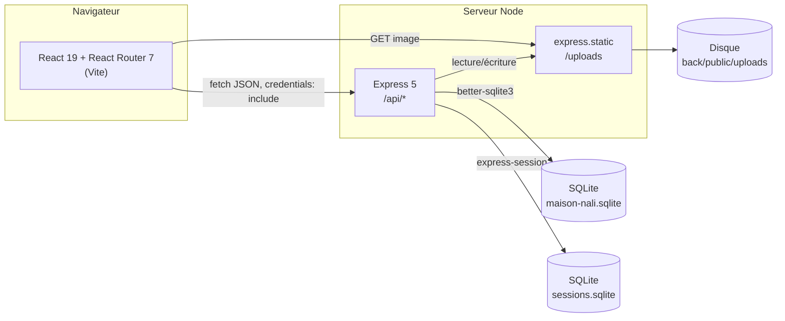
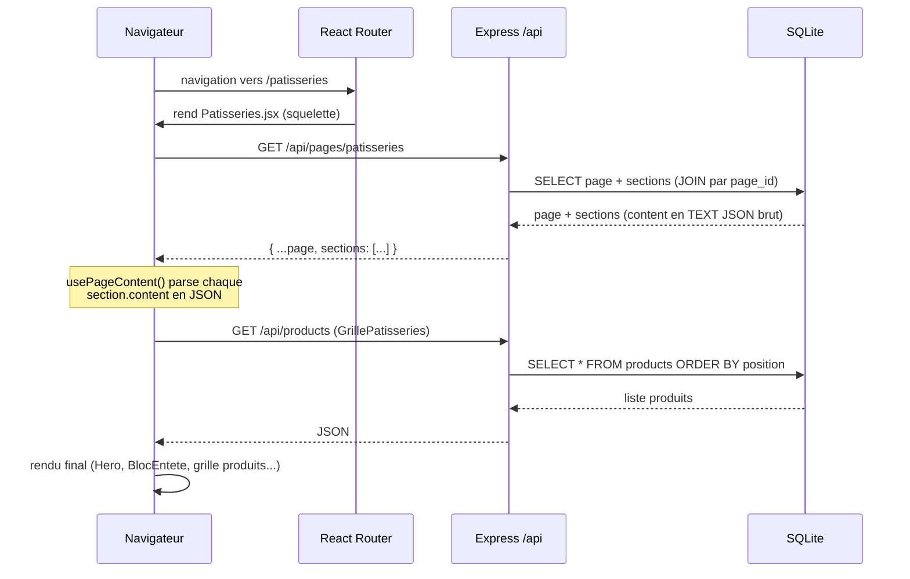
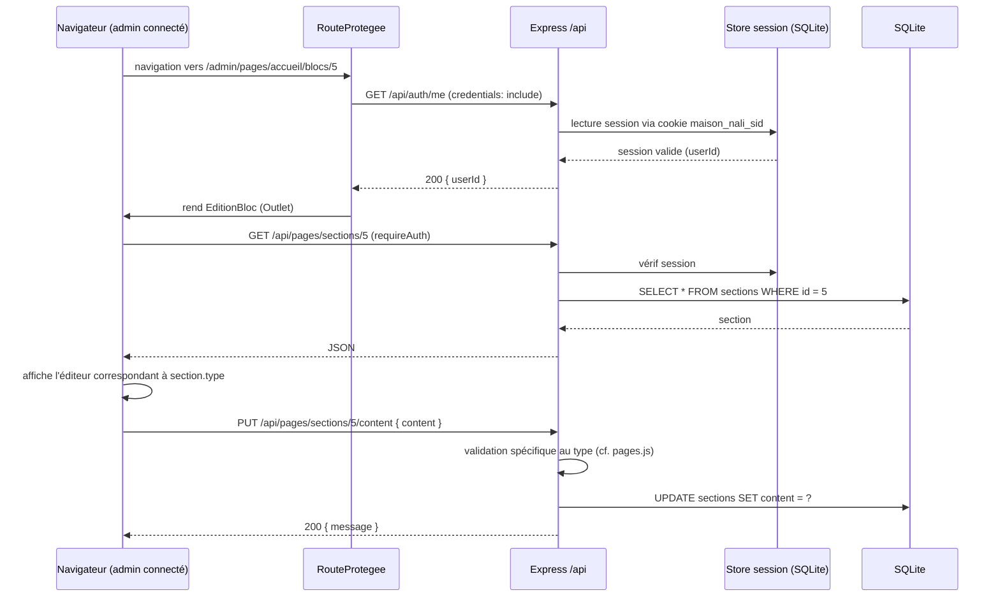
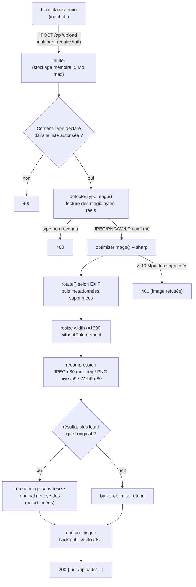

# Architecture

Tout ce document est vérifié directement dans le code (`back/src`, `front/src`) au moment de la rédaction (2026-10-10, branche `docs/v1`).

## Vue d'ensemble

Application deux tiers : un front React (SPA, rendu 100% côté client) qui parle en HTTP/JSON à un back Express, lui-même adossé à une base SQLite unique sur disque. Pas de SSR, pas de serveur de rendu intermédiaire.

## Couches

### Front (`front/`)

- **React 19** + **React Router 7** (`front/src/App.jsx`) : toutes les routes sont déclarées dans un seul arbre `<Routes>`, pas de framework méta (pas de Next.js/Remix).
- **Vite 8** comme bundler/dev server.
- **Tailwind CSS 4** (plugin Vite, pas de config `tailwind.config.js` séparée — classes utilitaires directement dans le JSX).
- Découpage en deux zones à l'exécution, cf. `front/src/App.jsx` :
  - zone **publique** (`SiteLayout`) : `Header`, `<main>`, `BanniereAnnonce`, `<Outlet>`, `Footer` — montée directement (import statique).
  - zone **admin** (`RouteProtegee` → `DashboardLayout`) : chargée en `React.lazy()` + `<Suspense>`, donc absente du bundle téléchargé par un visiteur public (cf. lot performance G1).
- Pas de store global (Redux/Zustand/Context partagé pour les données) : chaque composant fetch ses propres données via `useEffect`/hooks dédiés (`usePageContent`, `usePageSeo`, `useLocalBusinessSchema`). Assumé comme duplication de requêtes connue (cf. `docs/../Documentation/A11y_Perf_Passe1_2026-10-09.md`, constat G6).

### Back (`back/`)

- **Express 5**, un seul process, un seul fichier d'entrée `back/src/server.js`.
- Découpage en 3 couches :
  - `src/routes/*.js` : définition des endpoints HTTP, validation des entrées, codes de retour.
  - `src/repositories/*.js` : accès SQL (requêtes préparées `better-sqlite3`), aucune logique HTTP.
  - `src/utils/*.js` : fonctions pures (validation de formats, détection de type image, optimisation image).
- Pas d'ORM : SQL écrit à la main, uniquement via requêtes préparées paramétrées (jamais de concaténation de chaîne dans une requête).
- Middlewares globaux (ordre réel dans `server.js`) : `helmet()` → `cors()` → `compression()` → `express.json()` → `session()` → routes `/api/*` → `express.static("/uploads")` → `/api/upload` → 404 → gestionnaire d'erreur générique.

### Base de données

SQLite, un seul fichier applicatif (`back/data/maison-nali.sqlite`) + un fichier séparé pour les sessions (`back/data/sessions.sqlite`). Détail des tables : `docs/BASE-DE-DONNEES.md`.

## Flux d'une requête — page publique (ex. `/patisseries`)

Aucune authentification sur ce chemin : `GET /api/pages/:slug`, `GET /api/products` et les autres lectures publiques n'ont pas de middleware `requireAuth` (table complète dans `docs/API.md`).

## Flux d'une requête — admin (édition d'un bloc)

`requireAuth` (`back/src/middleware/requireAuth.js`) vérifie uniquement `req.session.userId` — pas de rôle/permission granulaire, un seul niveau d'accès (le compte admin unique).

## Sections et contenu JSON

Les pages publiques ne sont pas codées en dur : chaque page (`pages`) est composée de blocs (`sections`), typés (`sections.type`), dont le contenu éditable est stocké en **JSON brut dans une colonne `TEXT`** (`sections.content`). Le front parse ce JSON à la volée (`usePageContent.js`) et route vers le composant d'affichage correspondant au `type`.

Types de blocs réellement gérés par l'éditeur admin (`front/src/pages/admin/EditionBloc.jsx`) :

| `type` | Composant d'édition | Composant d'affichage public |
|---|---|---|
| `hero` | `EditionHero` | `Hero` |
| `bloc-patisseries` | `EditionGrillePatisseries` | `GrillePatisseries` (lit en réalité `products`, pas son propre `content`) |
| `bloc-histoire` | `EditionBlocHistoire` | `BlocHistoire` |
| `bloc-localisation` | `EditionBlocLocalisation` | `BlocLocalisation` |
| `bloc-evenements` | `EditionBlocEvenements` | `BlocEvenements` |
| `bloc-entete` | `EditionBlocEntete` | `BlocEntete` |

Chaque type a ses propres règles de validation appliquées côté back dans `PUT /api/pages/sections/:id/content` (`back/src/routes/pages.js`), au cas par cas selon `section.type` — pas de schéma JSON générique.

## Session

- `express-session`, cookie nommé `maison_nali_sid` (`back/src/constants.js`).
- Store **maison** (`back/src/db/sqliteSessionStore.js`), pas de paquet tiers — persistance dans `back/data/sessions.sqlite` (table `sessions`, colonnes `sid`/`sess`/`expire`), purge périodique des sessions expirées.
- En `NODE_ENV=test`, le store maison est court-circuité : `MemoryStore` par défaut d'`express-session` est utilisé (cf. `server.js`).
- `cookie.maxAge` = 24h, `httpOnly: true`, `sameSite: "lax"`, `secure` = `true` uniquement si `NODE_ENV=production`.
- Connexion (`POST /api/auth/login`) : `req.session.regenerate()` avant d'y placer `userId`, pour empêcher la fixation de session.
- Un seul rôle : le compte `users` connecté. Pas de distinction admin/éditeur/etc.

## Uploads et pipeline d'optimisation d'image

Points clés vérifiés dans le code (`back/src/routes/upload.js`, `back/src/utils/optimiserImage.js`, `back/src/utils/detecterTypeImage.js`) :

- Le fichier n'est **jamais** écrit avec le nom ou l'extension fournis par le client : l'extension vient du type réellement détecté (magic bytes), le nom est généré (`Date.now()-random`).
- Double contrôle de type : `Content-Type` déclaré (rapide, insuffisant seul) **puis** signature binaire réelle des premiers octets.
- Pipeline `sharp` appliqué uniquement sur le flux retenu pour l'écriture — jamais le buffer brut reçu du client.
- `back/src/db/optimize-uploads.js` applique le même pipeline a posteriori aux fichiers déjà présents sur disque (mode dry-run par défaut, détails dans `docs/DEPLOY.md` et le rapport `Documentation/A11y_Perf_Passe1_2026-10-09.md`).
- Les fichiers servis statiquement (`express.static`, `maxAge: "7d"`) ne passent par aucune authentification — ce sont des photos publiques du site.
