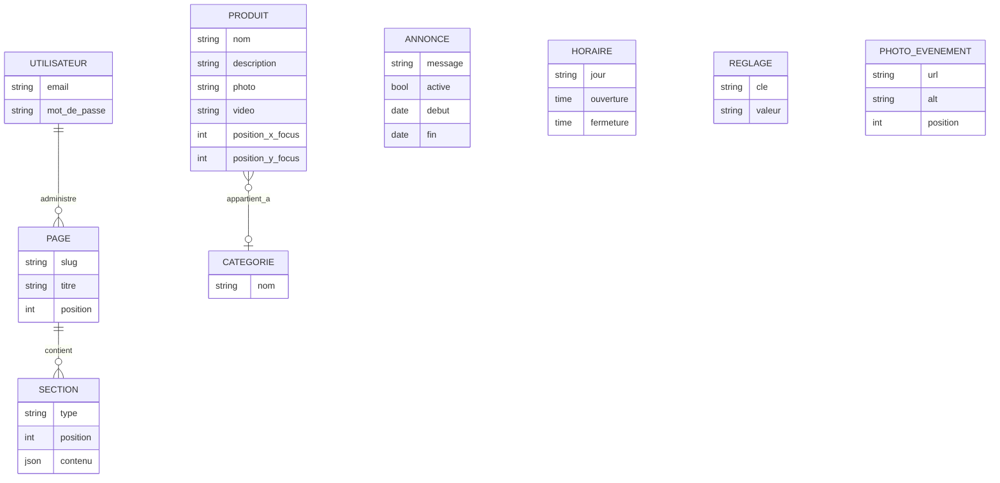
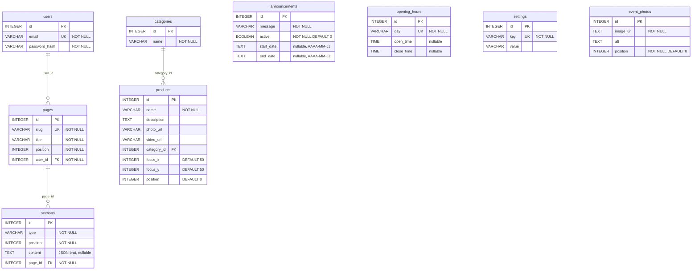

# Base de données

SQLite, un seul fichier applicatif : `back/data/maison-nali.sqlite` (gitignoré, jamais versionné). Schéma source : `back/src/db/database.sql`, appliqué par `node src/db/init.js` (`npm run init-db`).

## Vérification database.sql vs schéma réel

**Méthode** : introspection directe de `back/data/maison-nali.sqlite` (`SELECT sql FROM sqlite_master WHERE type IN ('table','index')`), comparée colonne par colonne à `database.sql`, le 2026-10-10. Les scripts `back/src/db/migrate-*.js` et `add-*.js` ont pu altérer le schéma depuis sa création initiale (ce sont des `ALTER TABLE` exécutés à la main, hors du fichier `database.sql`).

**Résultat : aucun écart constaté.** Les 9 tables et l'unique index (`idx_opening_hours_day`) du fichier réel correspondent exactement à ce que déclare `database.sql`, colonne pour colonne, y compris les colonnes manifestement ajoutées après coup par migration (`announcements.start_date`/`end_date`, `products.focus_x`/`focus_y`/`position`) — visibles dans le schéma réel par leur formatage SQL différent (ajoutées en fin de `CREATE TABLE` d'origine par `ALTER TABLE ... ADD COLUMN`), mais présentes aussi dans `database.sql`. Interprétation : `database.sql` a été tenu à jour manuellement après chaque migration. Rien à corriger (consigne : signaler sans corriger — ici il n'y a rien à signaler).

## MCD — Modèle conceptuel de données

Entités et relations porteuses de sens métier. `categories`, `settings`, `opening_hours`, `announcements` et `event_photos` sont des entités indépendantes (aucune clé étrangère entrante/sortante dans le schéma réel) ; `products.category_id` existe dans le schéma mais `categories` n'est pas utilisée par le front actuel (cf. `docs/API.md`).



## MLD — Modèle logique de données

```
users(id, email, password_hash)

pages(id, slug, title, position, user_id)
  FK user_id -> users.id

sections(id, type, position, content, page_id)
  FK page_id -> pages.id

categories(id, name)

products(id, name, description, photo_url, video_url, category_id, focus_x, focus_y, position)
  FK category_id -> categories.id

announcements(id, message, active, start_date, end_date)

opening_hours(id, day, open_time, close_time)
  UNIQUE(day)

settings(id, key, value)
  UNIQUE(key)

event_photos(id, image_url, alt, position)
```

## MPD — Modèle physique de données (DDL réel)

Reproduction exacte de `back/src/db/database.sql` (vérifiée identique au schéma réel ci-dessus) :



Pas de `ON DELETE CASCADE` déclaré sur les clés étrangères (`FOREIGN KEY (user_id) REFERENCES users(id)` sans action) — une suppression d'utilisateur ou de catégorie référencée échouerait ou laisserait des lignes orphelines selon le mode de contraintes actif (SQLite n'active `PRAGMA foreign_keys` que si explicitement demandé ; non vérifié ici si c'est le cas en exécution — cf. `back/src/db/connection.js`, aucun `PRAGMA foreign_keys = ON` trouvé).

## Dictionnaire des tables

### `users`
Un seul compte dans l'usage réel (pas de gestion multi-utilisateur côté front). `password_hash` : bcrypt, coût 12 (`back/src/repositories/auth.js`).

| Colonne | Type | Contrainte | Rôle |
|---|---|---|---|
| `id` | INTEGER | PK autoincrement | identifiant |
| `email` | VARCHAR | UNIQUE, NOT NULL | identifiant de connexion |
| `password_hash` | VARCHAR | NOT NULL | hash bcrypt, jamais le mot de passe en clair |

### `pages`
5 pages publiques créées par `init-pages.js` : `accueil`, `patisseries`, `evenements`, `a-propos`, `adresse`. `position` pilote l'ordre dans la nav admin (`DashboardLayout.jsx` a cependant son propre ordre codé en dur, indépendant de cette colonne).

| Colonne | Type | Contrainte | Rôle |
|---|---|---|---|
| `id` | INTEGER | PK | identifiant |
| `slug` | VARCHAR | UNIQUE, NOT NULL | utilisé dans l'URL (`/patisseries`) et par `GET /api/pages/:slug` |
| `title` | VARCHAR | NOT NULL | titre affiché côté admin |
| `position` | INTEGER | NOT NULL | ordre |
| `user_id` | INTEGER | FK → `users.id`, NOT NULL | auteur (non exploité pour du multi-auteur) |

### `sections`
Bloc de contenu éditable, rattaché à une page. `content` est une chaîne JSON libre dont la forme dépend de `type` (voir `docs/ARCHITECTURE.md`). Aucune contrainte SQL sur la forme du JSON — toute la validation est faite côté route (`back/src/routes/pages.js`) à l'écriture.

| Colonne | Type | Contrainte | Rôle |
|---|---|---|---|
| `id` | INTEGER | PK | identifiant |
| `type` | VARCHAR | NOT NULL | `hero` / `bloc-patisseries` / `bloc-histoire` / `bloc-localisation` / `bloc-evenements` / `bloc-entete` |
| `position` | INTEGER | NOT NULL | ordre d'affichage sur la page |
| `content` | TEXT | nullable | JSON brut, structure dépendante de `type` |
| `page_id` | INTEGER | FK → `pages.id`, NOT NULL | page parente |

### `categories`
Table présente en base et référencée par `products.category_id`, mais **non pilotée par le front** (aucun écran admin, aucune route appelée depuis `front/src` — `back/src/routes/categories.js` porte un commentaire explicite "prévu pour une V2").

| Colonne | Type | Contrainte | Rôle |
|---|---|---|---|
| `id` | INTEGER | PK | identifiant |
| `name` | VARCHAR | NOT NULL | nom de catégorie |

### `products`
Catalogue des pâtisseries, géré depuis `/admin/produits`.

| Colonne | Type | Contrainte | Rôle |
|---|---|---|---|
| `id` | INTEGER | PK | identifiant |
| `name` | VARCHAR | NOT NULL | nom du produit |
| `description` | TEXT | nullable | description |
| `photo_url` | VARCHAR | nullable | chemin `/uploads/...` |
| `video_url` | VARCHAR | nullable | lien externe (YouTube/Instagram...) |
| `category_id` | INTEGER | FK → `categories.id`, nullable | non utilisé par l'UI actuelle |
| `focus_x` | INTEGER | DEFAULT 50 | point focal horizontal de recadrage CSS (`object-position`), 0-100 |
| `focus_y` | INTEGER | DEFAULT 50 | point focal vertical, 0-100 |
| `position` | INTEGER | DEFAULT 0 | ordre d'affichage (`/admin/produits`, drag & drop `@dnd-kit`) |

### `announcements`
Une seule ligne utilisée en pratique (bannière d'annonce du site public), gérée depuis `/admin/banniere`. Visibilité calculée côté back selon la date du jour à Paris (`back/src/utils/bannerVisibility.js`).

| Colonne | Type | Contrainte | Rôle |
|---|---|---|---|
| `id` | INTEGER | PK | identifiant |
| `message` | VARCHAR | NOT NULL | texte de la bannière |
| `active` | BOOLEAN | NOT NULL, DEFAULT 0 | activée/désactivée manuellement |
| `start_date` | TEXT | nullable | `AAAA-MM-JJ`, bannière invisible avant cette date |
| `end_date` | TEXT | nullable | `AAAA-MM-JJ`, bannière invisible après cette date |

### `opening_hours`
7 lignes (une par jour), créées par `seed-opening-hours.js`. Gérées depuis `/admin/coordonnees`.

| Colonne | Type | Contrainte | Rôle |
|---|---|---|---|
| `id` | INTEGER | PK | identifiant |
| `day` | VARCHAR | UNIQUE (index `idx_opening_hours_day`), NOT NULL | nom du jour en français (`Lundi`...) |
| `open_time` | TIME | nullable | heure d'ouverture `HH:MM`, `NULL` = fermé |
| `close_time` | TIME | nullable | heure de fermeture `HH:MM`, `NULL` = fermé |

### `settings`
Paires clé/valeur libres. Clés réellement utilisées par le front : `phone`, `address_text`, `social_instagram`, `social_facebook`, `social_tiktok`. Gérées depuis `/admin/coordonnees`.

| Colonne | Type | Contrainte | Rôle |
|---|---|---|---|
| `id` | INTEGER | PK | identifiant |
| `key` | VARCHAR | UNIQUE, NOT NULL | nom du réglage |
| `value` | VARCHAR | nullable | valeur |

### `event_photos`
Galerie "nos réalisations" de la page Événements, limitée à 5 photos (`LIMITE_PHOTOS` dans `back/src/repositories/eventPhotos.js`). Gérée depuis `/admin/photos-evenements`.

| Colonne | Type | Contrainte | Rôle |
|---|---|---|---|
| `id` | INTEGER | PK | identifiant |
| `image_url` | TEXT | NOT NULL | chemin `/uploads/...` |
| `alt` | TEXT | nullable | texte alternatif (accessibilité) |
| `position` | INTEGER | NOT NULL, DEFAULT 0 | ordre dans le carrousel |

## Sessions (hors `maison-nali.sqlite`)

Les sessions ne sont **pas** dans la base applicative : fichier séparé `back/data/sessions.sqlite`, table unique `sessions(sid TEXT PRIMARY KEY, sess TEXT NOT NULL, expire INTEGER NOT NULL)`, créée au runtime par `back/src/db/sqliteSessionStore.js` (pas dans `database.sql`). Détail du fonctionnement : `docs/ARCHITECTURE.md`.
