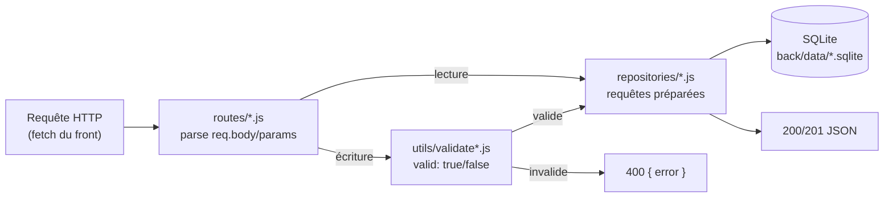

# Structure du dépôt

Arbre annoté, vérifié contre `git ls-files` le 2026-10-11 (branche `docs/code`). Un rôle en une ligne par fichier. Pour le détail (flux de requête, schéma JSON des sections, pipeline d'upload), voir `docs/ARCHITECTURE.md`.

## Racine

| Fichier | Rôle |
|---|---|
| `README.md` | Présentation du projet, installation rapide, index de la documentation |
| `SETUP.md` | Installation détaillée pas à pas, pièges Windows connus |
| `.gitignore` | Fichiers non versionnés (dépendances, builds, données locales, config d'outils d'assistance au dev) |
| `.editorconfig` | Conventions d'édition (indentation...) partagées entre éditeurs |
| `.gitattributes` | Normalisation des fins de ligne par git |

## `back/` — API Express + SQLite

| Fichier | Rôle |
|---|---|
| `.env.example` | Modèle de configuration (`SESSION_SECRET`, `PORT`, `FRONT_URL`, `TRUST_PROXY`) |
| `.nvmrc` | Version Node attendue (`nvm use`) |
| `package.json` / `package-lock.json` | Dépendances et scripts npm |
| `data/.gitkeep` | Force la présence du dossier (bases SQLite elles-mêmes gitignorées) |
| `public/uploads/.gitkeep` | Force la présence du dossier (photos uploadées elles-mêmes gitignorées) |
| `seed/contenu.json` | Export figé du contenu éditorial réel, source de `content:import` |

### `back/src/`

| Fichier | Rôle |
|---|---|
| `server.js` | Point d'entrée : middlewares globaux, montage de toutes les routes |
| `constants.js` | Constantes partagées (nom du cookie de session) |

### `back/src/db/` — connexion, schéma, scripts utilitaires

| Fichier | Rôle |
|---|---|
| `connection.js` | Connexion SQLite unique, partagée par tous les repositories |
| `database.sql` | Schéma source de la base applicative |
| `init.js` | Crée la base depuis `database.sql` (`npm run init-db`) |
| `init-admin.js` | Crée le compte admin (CLI manuel) |
| `init-test.js` | Régénère la base de test avant chaque run (`pretest`) |
| `testEnv.js` | Force `NODE_ENV=test` avant tout chargement de module |
| `backup.js` | Sauvegarde bases + uploads dans un dossier horodaté (`npm run backup`) |
| `sauvegardeRecente.js` | Localise la sauvegarde la plus récente (garde-fou des scripts `--force`/`--apply`) |
| `fichiersReferences.js` | Liste tous les fichiers `/uploads/...` référencés en base |
| `content-export.js` | Exporte le contenu éditorial réel vers `seed/contenu.json` (`npm run content:export`) |
| `content-export-import.test.js` | Tests du round-trip export/import et de ses garde-fous |
| `content-import.js` | Importe `seed/contenu.json` dans une base (`npm run content:import`) |
| `optimize-uploads.js` | Réapplique le pipeline d'optimisation d'image aux fichiers déjà uploadés |
| `sqliteSessionStore.js` | Store de session `express-session` maison, persistant dans `sessions.sqlite` |
| `sqliteSessionStore.test.js` | Tests du store de session |

### `back/src/middleware/`

| Fichier | Rôle |
|---|---|
| `requireAuth.js` | Bloque une route (401) si aucune session admin n'est ouverte |
| `rateLimitLogin.js` | Limite les tentatives de connexion par IP (anti force-brute) |
| `rateLimitLogin.test.js` | Tests du rate limiting |

### `back/src/repositories/` — accès SQL, pas de logique HTTP

| Fichier | Rôle |
|---|---|
| `connection` (voir `db/`) | — |
| `announcements.js` / `.test.js` | Table `announcements` (bannière, une seule ligne) |
| `auth.js` | Hachage/vérification de mot de passe (bcrypt) |
| `categories.js` / `.test.js` | Table `categories` (prévue pour une V2, non branchée) |
| `eventPhotos.js` / `.test.js` | Table `event_photos` (galerie événements, limite de 5) |
| `openingHours.js` / `.test.js` | Table `opening_hours` (7 lignes fixes) |
| `pages.js` | Table `pages` (6 pages fixes du site) |
| `products.js` / `.test.js` | Table `products` (catalogue public) |
| `sections.js` | Table `sections` (contenu JSON de chaque bloc de page) |
| `settings.js` / `.test.js` | Table `settings` (clé/valeur génériques) |
| `users.js` | Table `users` (comptes admin uniquement) |

### `back/src/routes/` — endpoints HTTP, validation, codes de retour

| Fichier | Rôle |
|---|---|
| `announcements.js` | Bannière : lecture filtrée par dates (public) / brute (admin), écriture |
| `auth.js` | Login (rate-limité), logout, session courante, changement de mot de passe |
| `categories.js` | Catégories (V2 non branchée) |
| `eventPhotos.js` / `.test.js` | Galerie événements : CRUD, réorganisation |
| `openingHours.js` | Horaires : lecture publique, mise à jour admin |
| `pages.js` / `.test.js` | Pages publiques + contenu de leurs sections |
| `products.js` | Catalogue : CRUD, réorganisation |
| `security.test.js` | Garde-fous transverses (auth requise, injection SQL) |
| `settings.js` | Réglages clé/valeur |
| `upload.js` / `.test.js` | Upload de photo : vérification du contenu réel, traitement sharp |

### `back/src/utils/` — fonctions pures

| Fichier | Rôle |
|---|---|
| `bannerVisibility.js` / `.test.js` | Date du jour à Paris, visibilité de la bannière selon ses dates |
| `detecterTypeImage.js` / `.test.js` | Détection du type d'image par signature binaire réelle |
| `optimiserImage.js` / `.test.js` | Pipeline sharp (rotation EXIF, métadonnées, redimensionnement) |
| `phone.js` / `.test.js` | Format de numéro de téléphone |
| `validateBannerDates.js` / `.test.js` | Cohérence des dates de la bannière |
| `validateBlocHistoire.js` / `.test.js` | Validation du bouton d'un bloc-histoire |
| `validateEventPhoto.js` / `.test.js` | Validation d'une entrée de galerie événements |
| `validateLienBouton.js` / `.test.js` | Validation d'un lien de bouton (interne ou https) |
| `validateOpeningHours.js` / `.test.js` | Validation d'une paire d'horaires |
| `validatePhotoInterne.js` / `.test.js` | Validation d'un chemin de photo uploadée |
| `validateSectionContent.js` | Validation du contenu JSON d'une section, selon son type |
| `validateSettingValue.js` | Validation d'une valeur de réglage, selon sa clé |

## `front/` — SPA React + Vite

| Fichier | Rôle |
|---|---|
| `.env.example` | Modèle de configuration (`VITE_API_URL`, `VITE_SITE_URL`) |
| `.nvmrc` | Version Node attendue |
| `.gitignore` | Spécificités front (dist, éditeurs) en plus du `.gitignore` racine |
| `README.md` | Généré par Vite (scaffold), non maintenu spécifiquement |
| `eslint.config.js` | Règles de lint (React, hooks, refresh) |
| `index.html` | Coquille HTML, point de montage `#root`, polices préchargées |
| `package.json` / `package-lock.json` | Dépendances et scripts npm |
| `vite.config.js` | Configuration du build (plugins React, Tailwind) |
| `scripts/generate-seo-files.js` | Génère `robots.txt`/`sitemap.xml` après le build |
| `public/favicon.svg` | Favicon |
| `public/fonts/*.woff2` | Polices auto-hébergées (variable, RGPD) |
| `public/images/Prendre Le Thé.webp` | Image Open Graph par défaut |

### `front/src/` — racine

| Fichier | Rôle |
|---|---|
| `main.jsx` | Point d'entrée Vite, monte `<App />` |
| `App.jsx` | Toutes les routes (public + admin lazy-loadées) |
| `index.css` | Import Tailwind, polices, thème (`@theme`) |

### `front/src/hooks/`

| Fichier | Rôle |
|---|---|
| `usePageContent.js` | Charge une page publique par slug, reparse le contenu JSON des sections |
| `usePageSeo.js` | Titre, meta description, canonique, Open Graph |
| `useLocalBusinessSchema.js` | Injecte les données structurées JSON-LD (schema.org) |
| `useSauvegardeBloc.js` | Sauvegarde le contenu d'une section (éditeurs admin) |

### `front/src/utils/`

| Fichier | Rôle |
|---|---|
| `urlImage.js` | Résout un chemin de photo vers une URL chargeable |
| `parseContenuSection.js` | Reparse le `content` JSON d'une section, jamais ne lève |
| `telephone.js` | Construit un lien `tel:` depuis un numéro affiché |
| `sessionExpiree.js` | Redirige vers la connexion admin sur 401/403 |
| `bannerStatus.js` | Statut lisible d'une annonce (Programmée/Expirée/Affichée) |

### `front/src/components/` — public, top-level

| Fichier | Rôle |
|---|---|
| `Header.jsx` | En-tête : logo, nav desktop, menu plein écran mobile accessible |
| `Footer.jsx` | Pied de page : nav secondaire, téléphone, réseaux |
| `ScrollToTop.jsx` | Remonte en haut de page à chaque changement de route |
| `BanniereAnnonce.jsx` | Bandeau d'annonce (affichage pur, visibilité déjà calculée) |
| `Hero.jsx` | Bloc hero (photo pleine largeur + titre + bouton) |
| `BlocEntete.jsx` | En-tête de page (titre + libellé + intro) |
| `BlocHistoire.jsx` | Bloc "notre histoire" (photo + texte + bouton) |
| `BlocLocalisation.jsx` | Bloc boutique (photo, adresse, horaires, itinéraire) |
| `BlocEvenements.jsx` | Galerie + formats + contact (page Événements) |
| `GrillePatisseries.jsx` | Grille du catalogue de pâtisseries |
| `CarrouselPhotos.jsx` | Carrousel de photos (scroll-snap natif) |
| `HorairesTable.jsx` | Tableau des horaires d'ouverture |
| `ChargementPage.jsx` | Repli pendant le chargement (anti-CLS) |
| `ServiceIndisponible.jsx` | Repli quand une page ne charge pas ses données |
| `ImageAvecRepli.jsx` | Repli commun sur toute image publique en échec de chargement |
| `PlaceholderPhoto.jsx` | Visuel de repli affiché par `ImageAvecRepli` |

### `front/src/components/admin/`

| Fichier | Rôle |
|---|---|
| `RouteProtegee.jsx` | Garde de route : vérifie la session côté serveur |
| `DashboardLayout.jsx` | Ossature des pages admin (nav latérale + contenu) |
| `editeurs/EditionHero.jsx` | Formulaire du bloc Hero (upload + point focal) |
| `editeurs/EditionBlocHistoire.jsx` | Formulaire d'un bloc-histoire |
| `editeurs/EditionBlocLocalisation.jsx` | Formulaire du bloc boutique + horaires |
| `editeurs/EditionBlocEvenements.jsx` | Formulaire des formats de boîtes |
| `editeurs/EditionBlocEntete.jsx` | Formulaire du bloc-entête |
| `editeurs/EditionGrillePatisseries.jsx` | Écran informatif (renvoie vers "Produits") |

### `front/src/pages/` — une entrée par route publique

| Fichier | Rôle |
|---|---|
| `Accueil.jsx` | Page d'accueil |
| `Patisseries.jsx` | Catalogue |
| `ProduitDetail.jsx` | Fiche produit (`/patisseries/:id`) |
| `APropos.jsx` | Histoire (jusqu'à 2 blocs) |
| `Adresse.jsx` | Boutique, horaires, itinéraire |
| `Evenements.jsx` | Galerie, formats, contact |
| `MentionsLegales.jsx` | Contenu fixe, téléphone dynamique |
| `NotFound.jsx` | Page 404 |

### `front/src/pages/admin/`

| Fichier | Rôle |
|---|---|
| `Connexion.jsx` | Écran de connexion |
| `ChangerMotDePasse.jsx` | Changement de mot de passe |
| `GestionPage.jsx` | Liste des blocs d'une page |
| `EditionBloc.jsx` | Route générique d'édition d'un bloc (délègue par type) |
| `GestionProduits.jsx` | Catalogue : CRUD, glisser-déposer |
| `GestionPhotosEvenements.jsx` | Galerie événements : upload, alt, glisser-déposer |
| `GestionBanniere.jsx` | Bannière d'annonce |
| `GestionReseaux.jsx` | Coordonnées (adresse, téléphone, réseaux) |

## Flux back : route → validateur → repository → SQLite

Aucune validation ne vit dans un repository : une route qui écrit appelle toujours un validateur avant d'appeler le repository. `content-import.js` (import en masse) réutilise les mêmes fonctions `validate*` que les routes — jamais de copie séparée des règles.

## Scripts utilitaires (`back/`, depuis `back/`)

| Commande | Script | Effet |
|---|---|---|
| `npm run init-db` | `src/db/init.js` | Crée la base depuis `database.sql` (une fois, base neuve) |
| `node src/db/init-admin.js <email> <mdp>` | `src/db/init-admin.js` | Crée le compte admin (une fois, avant `content:import`) |
| `npm run content:import` | `src/db/content-import.js` | Importe le contenu réel depuis `seed/contenu.json` |
| `npm run content:export` | `src/db/content-export.js` | Régénère `seed/contenu.json` depuis une base qui a du contenu |
| `npm run backup` | `src/db/backup.js` | Sauvegarde bases + uploads dans `Sauvegardes/<horodatage>/` |
| `node src/db/optimize-uploads.js [--apply]` | `src/db/optimize-uploads.js` | Réapplique le pipeline d'optimisation aux fichiers déjà uploadés |

Détail complet (garde-fous, options `--force`/`--apply`, exigences de sauvegarde) : `docs/DEPLOY.md`.
